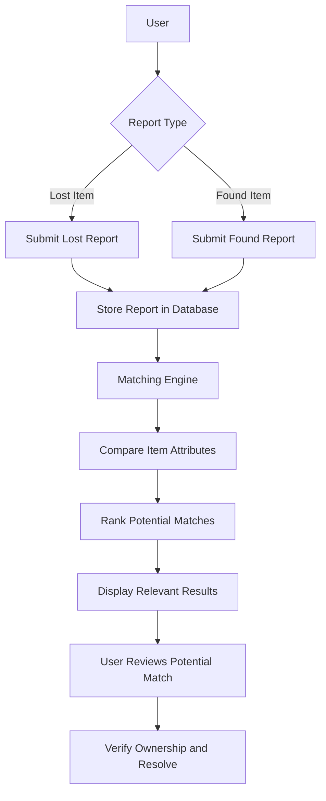

# LostLink — Lost & Found, Reconnected.

<p align="center">
  
  
  
</p>

<p align="center">
  <strong>Connecting lost belongings with the people searching for them.</strong>
  <br/>
  A smarter, algorithm-driven Lost & Found platform built with the MERN stack.
</p>

---

## About LostLink

**LostLink** is a web-based Lost & Found platform designed to help people report lost belongings, publish found-item reports, and identify potential matches through an organized, intelligent matching system.

Losing a valuable item can be stressful, and finding its owner can be equally challenging. Traditional approaches often rely on scattered social media posts, manual searching, and unorganized information.

LostLink aims to bring this process into one centralized platform where users can submit item details, discover relevant reports, and connect lost belongings with their rightful owners.

More than just a CRUD application, LostLink is being developed as a **Data Structures and Algorithms (DSA) project**, exploring how data structures, searching techniques, and matching algorithms can improve the efficiency of Lost & Found operations.

> **Our vision:** Make finding lost belongings easier, faster, and more organized — one connection at a time.

##  Key Features

### Lost & Found Reporting
- Report lost belongings with relevant item details.
- Publish found-item reports to help locate their owners.
- Organize reports by item type, description, location, and other relevant attributes.
- Manage submitted reports through a structured workflow.

###  Intelligent Item Matching
- Compare lost-item reports with found-item reports.
- Evaluate relevant attributes such as item category, keywords, and location.
- Rank potential matches using a matching algorithm.
- Help users focus on the most relevant results instead of manually searching every report.

*Matching criteria and ranking behavior will evolve as the algorithm is implemented.*

###  User Management
- User registration and authentication.
- Access to relevant item reports and matching results.
- A foundation for user-specific reporting and item management.

### ⚡ DSA-Powered Architecture
- Explore linear data structures for managing item records.
- Investigate efficient searching and filtering techniques.
- Use algorithmic matching to identify potential lost-and-found pairs.
- Explore temporary in-memory data structures and expiration-based cleanup for recently created or updated reports.

###  Future Enhancements
- Real-time match notifications.
- Advanced filters for category, location, and date.
- Image-assisted item identification.
- Report status tracking, including resolved cases.
- More efficient matching and ranking algorithms.
- An administrative interface for moderation and abuse prevention.

*Features marked as future enhancements are planned possibilities, not necessarily implemented functionality.*

---

##  How LostLink Works



### Typical workflow

1. **Report:** A user submits a lost-item or found-item report.
2. **Store:** The report is validated and stored in the database.
3. **Match:** The matching engine compares relevant lost and found records.
4. **Rank:** Potential matches are prioritized according to the implemented matching criteria.
5. **Review:** Users review the suggested results and determine whether a match is genuine.
6. **Resolve:** The owner and finder can proceed through the application's supported resolution workflow.

**Important:** An algorithmic match is only a suggestion. Users should verify ownership before handing over an item.

---

## Data Structures & Algorithms

LostLink is designed to demonstrate the practical application of DSA concepts in a real-world problem.

| Concept | Potential Application |
|---|---|
| Arrays / Lists | Organizing item records and search results |
| Linear Search | Comparing records against selected criteria |
| Hash Maps | Indexing item attributes for faster lookups |
| Queues | Processing matching tasks in a first-in, first-out order |
| Sorting | Ranking candidate matches by relevance |
| String Matching | Comparing item descriptions and keywords |
| Time-Based Cleanup | Expiring temporary cached records |
| Matching Score | Ranking potential lost-and-found pairs |

These are design options, not a claim that every listed structure or algorithm has already been implemented.

### Matching algorithm — proposed approach

A matching engine could calculate a score using attributes such as:

- Item category
- Description and keywords
- Color or distinguishing characteristics
- Location proximity
- Report date

The system could then rank candidates from highest to lowest score and display the most relevant suggestions first.

The exact scoring formula, data structures, and time complexity will depend on the final implementation.

---

## Tech Stack

| Technology | Purpose |
|---|---|
| MongoDB | Document database for item reports and user data |
| Express.js | Backend routing and API development |
| React.js | Interactive user interface |
| Node.js | JavaScript runtime for the backend |
| JavaScript | Application logic and matching algorithms |
| Git & GitHub | Version control and team collaboration |

<p align="center">
  
</p>

*The stack and tools shown reflect the intended project architecture; update this section if the implementation changes.*

---

## 🏗️ Project Structure

The repository may follow this structure as development progresses:

```text
LostLink/
│
├── Frontend/
│   ├── public/
│   ├── src/
│   │   ├── components/
│   │   ├── pages/
│   │   ├── services/
│   │   ├── hooks/
│   │   └── App.jsx
│   └── package.json
│
├── Backend/
│   ├── config/
│   ├── controllers/
│   ├── middleware/
│   ├── models/
│   ├── routes/
│   ├── services/
│   ├── utils/
│   ├── app.js
│   ├── server.js
│   └── package.json
│
├── docs/
├── .gitignore
└── README.md
```

*Adjust this tree to match the actual folders and filenames in your repository.*

---

## 🚀 Getting Started

Follow these steps to run LostLink locally once the frontend and backend setup is available.

### Prerequisites

Make sure you have installed:

- [Node.js](https://nodejs.org/)
- npm (included with Node.js)
- [MongoDB](https://www.mongodb.com/) or an appropriate MongoDB connection
- [Git](https://git-scm.com/)

### 1. Clone the repository

```bash
git clone YOUR_REPOSITORY_URL
cd LostLink
```

Replace `YOUR_REPOSITORY_URL` with your actual GitHub repository URL.

### 2. Set up the backend

```bash
cd Backend
npm install
```

Create a `.env` file in the backend directory using the environment variables expected by your application.

Example:

```env
PORT=5000
MONGO_URI=your_mongodb_connection_string
SESSION_SECRET=your_secure_session_secret
```

Use only the variables your backend actually requires. Never commit real credentials, database passwords, or session secrets.

Start the backend using the script configured in `Backend/package.json`. For example:

```bash
npm run dev
```

### 3. Set up the frontend

Open a separate terminal:

```bash
cd Frontend
npm install
npm run dev
```

If your frontend uses a different development command, follow the script defined in its `package.json`.

### 4. Open the application

Visit the local URL displayed by your frontend development server.

**Note:** These instructions are a template. Confirm the actual directory names, environment variables, npm scripts, and frontend API configuration before publishing the README as a verified setup guide.

---

## 👥 Meet the Team

LostLink is developed by a team of **three computer science students**, collaborating to build a practical software solution while applying data structures, algorithms, and full-stack development concepts.

Add each member's real name and social links below.

### 👨‍💻 Team Member 01

**Name:** Vaniza Batool

- **Role:** Project Lead / Full-Stack Developer
- **GitHub:** [Vaniza Batool](https://github.com/vanizabatool-cs)
- **LinkedIn:** [Vaniza Batool](https://www.linkedin.com/in/vaniza-batool-5157663a3/)

### 👨‍💻 Team Member 02

**Name:** Bilal Ali

- **Role:** Frontend Developer / UI & Integration
- **GitHub:** [@github-username](https://github.com/github-username)
- **LinkedIn:** [LinkedIn Profile](https://www.linkedin.com/in/linkedin-username/)

### 👨‍💻 Team Member 03

**Name:**  Ishtiaque Ali

- **Role:** Backend Developer
- **GitHub:** [IshtiaqueDev](https://github.com/IshtiaqueDev)
- **LinkedIn:** [Ishtiaque Ali](https://www.linkedin.com/in/ishtiaqueali3/)

*Roles are suggested starting points. Replace them with your team's actual responsibilities and acknowledge each member's contributions accurately.*

---

## 🤝 Collaboration & Contribution

We use Git and GitHub to collaborate, review changes, and maintain a shared codebase.

### Our workflow

1. Clone the repository.
2. Create a dedicated branch for your task.
3. Implement and test your changes.
4. Commit your work with a meaningful message.
5. Push the branch to GitHub.
6. Open a Pull Request for review.
7. Merge changes after review and resolving conflicts.

### Example Git commands

```bash
git clone YOUR_REPOSITORY_URL
cd LostLink

git checkout -b feature/your-feature

git add .
git commit -m "Add item matching logic"

git push -u origin feature/your-feature
```

Use descriptive branch names, such as:

- `feature/lost-item-report`
- `feature/found-item-report`
- `feature/matching-algorithm`
- `fix/authentication-error`
- `docs/update-readme`

Please do not commit `.env` files, credentials, generated dependencies, or unrelated changes.

---

## 🔐 Security & Privacy

LostLink is intended to handle information about users and their belongings responsibly.

- Never publish passwords, access tokens, or private credentials.
- Validate and sanitize user-submitted data.
- Protect routes and user-specific operations with appropriate authorization.
- Avoid exposing sensitive personal information in public reports.
- Verify ownership before returning a found item.
- Review uploaded images and user reports for inappropriate or misleading content.

Security measures should be documented as they are implemented and tested.

---

## 🎯 Project Goals

Our goals are to:

- Build a functional and user-friendly Lost & Found application.
- Apply DSA concepts to a meaningful real-world problem.
- Explore efficient searching, filtering, and matching techniques.
- Strengthen our MERN stack development skills.
- Practice collaborative development using Git and GitHub.
- Deliver a project that can be extended beyond an academic demonstration.

---

## 🗺️ Roadmap

- [ ] Establish frontend and backend architecture.
- [ ] Implement lost-item and found-item reporting.
- [ ] Integrate MongoDB models and API endpoints.
- [ ] Implement authentication and authorization.
- [ ] Develop the initial matching algorithm.
- [ ] Add ranking, filtering, and search improvements.
- [ ] Implement temporary caching and time-based cleanup where appropriate.
- [ ] Test API endpoints, edge cases, and matching accuracy.
- [ ] Improve responsive design and accessibility.
- [ ] Deploy the application and document its live URL.

Update these checkboxes as features are completed and tested.

---

## 📸 Screenshots & Demo

Add screenshots or a short demonstration video here as the user interface becomes available.

Suggested screenshots:

- Landing page
- Lost-item reporting form
- Found-item reporting form
- Matching results
- User dashboard

**Live Demo:** Add your deployed application URL when available.

**Project Repository:** Add your GitHub repository URL.

---

## 📄 License

A license has not yet been specified.

Before making the project openly reusable, choose a license that matches the team's intentions and add a `LICENSE` file to the repository.

---

## 💙 Built With Purpose

LostLink is a collaborative learning project focused on solving a practical problem through software engineering, data structures, algorithms, and teamwork.

**One report. One connection. One step closer to finding what's lost.**

<p align="center">
  Made with 💙 by the DarkX Team
</p>
